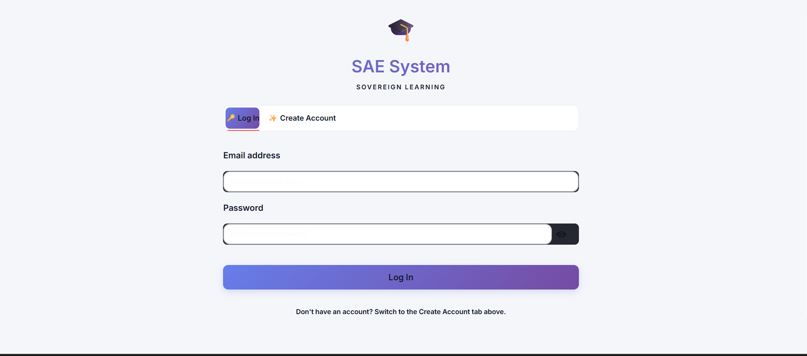
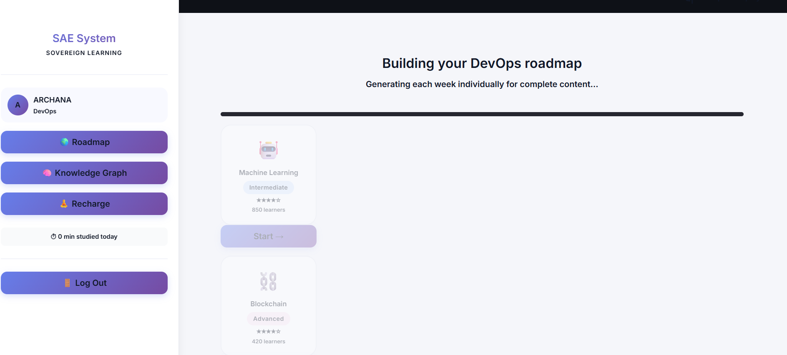
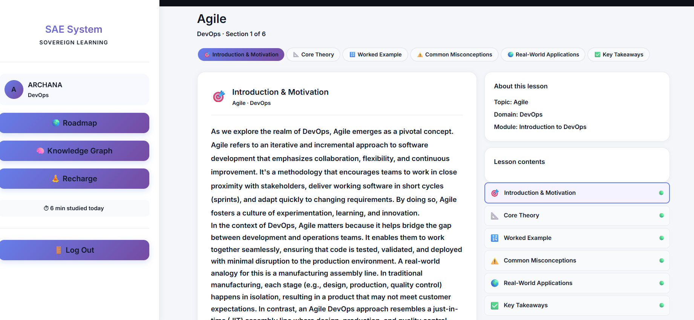
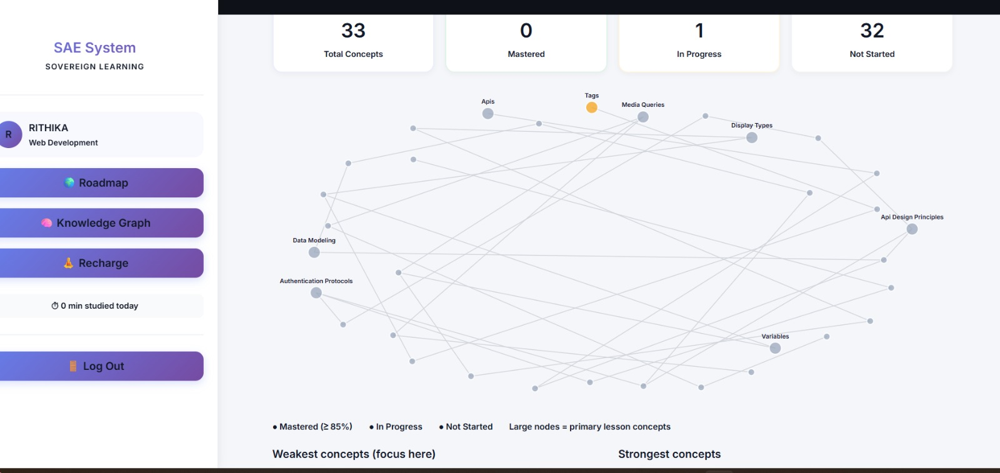
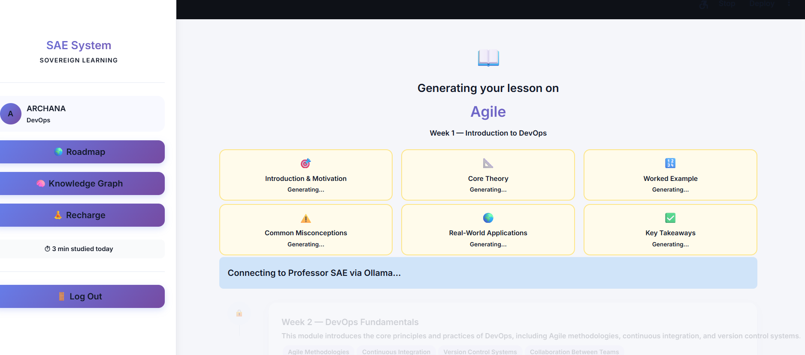

# 🎓 Sovereign Autonomous Education (SAE)
### A Local-First, Multi-Agent Intelligent Tutoring System

[](https://python.org)
[](https://github.com/langchain-ai/langgraph)
[](https://ollama.ai)
[](https://www.trychroma.com)
[](https://streamlit.io)
[](LICENSE)
[](https://github.com/Rithika-alt/SAE-Sovereign_Autonomous_Education-ITS-)

> **Zero cloud dependency. Full data sovereignty. AI tutoring that actually understands you.**

SAE is a fully local, privacy-preserving Multi-Agent Intelligent Tutoring System (ITS) that personalises learning paths, teaches interactively, grades subjective answers on *conceptual understanding* (not keyword matching), and issues cryptographically verifiable Proof-of-Learning credentials — all without sending a single byte of student data to an external server.

---

## ✨ Why SAE?

| Problem with existing AI tutors | How SAE solves it |
|---|---|
| Send all student data to cloud APIs (OpenAI, Google) | 100% local inference via Ollama — zero data leaves your machine |
| Grade answers by keyword matching — penalises paraphrase-correct responses | Cosine similarity on Sentence Transformer embeddings evaluates *meaning*, not words |
| No long-term memory of student progress | Dynamic Knowledge Graph (Neo4j) tracks concept mastery across sessions |
| No verifiable proof of what was learned | SHA-256 cryptographic mastery certificates, independently auditable |
| Generic one-size-fits-all curriculum | 4 autonomous agents build a personalised path per student, per domain |

---

## 🏗️ Architecture

```
┌─────────────────────────────────────────────────────────┐
│                  LAYER 1: MULTIMODAL INGESTION           │
│         Text Parser │ Whisper Audio │ Vision │ Biometric │
└──────────────────────────┬──────────────────────────────┘
                           │
┌──────────────────────────▼──────────────────────────────┐
│            LAYER 2: AGENTIC ORCHESTRATION (LangGraph)    │
│   ┌─────────────┐  ┌──────────────┐  ┌───────────────┐  │
│   │ Tutor Agent │  │Searcher Agent│  │ Auditor Agent │  │
│   │(Curriculum) │  │ (RAG/Web)    │  │ (Grading)     │  │
│   └─────────────┘  └──────────────┘  └───────────────┘  │
│              ◄── Self-Correction Audit Loop ──►          │
└──────────────────────────┬──────────────────────────────┘
                           │
┌──────────────────────────▼──────────────────────────────┐
│           LAYER 3: SOVEREIGN MEMORY ARCHITECTURE         │
│        ChromaDB (Vector DB) │ Neo4j (Knowledge Graph)    │
└──────────────────────────┬──────────────────────────────┘
                           │
┌──────────────────────────▼──────────────────────────────┐
│              LAYER 4: TRUST & VERIFICATION               │
│     Anti-Malpractice Audit │ SHA-256 Proof-of-Learning   │
└─────────────────────────────────────────────────────────┘
```

---

## 🤖 The Four Agents

| Agent | Role |
|---|---|
| **🗺️ Roadmap Agent** | Queries the knowledge graph and builds a personalised multi-week learning path based on the student's current mastery frontier |
| **📚 Tutor Agent** | Generates structured lesson content via local Ollama LLM inference — Introduction, Core Theory, Worked Example, Misconceptions, Applications, Takeaways |
| **🔍 Searcher Agent** | Triggered when a concept is absent from ChromaDB — performs constrained web retrieval, embeds and writes back to the local vector store |
| **✅ Auditor Agent** | Evaluates student answers using the composite semantic score (cosine similarity × 0.7 + Socratic probe × 0.3) with anti-malpractice verification |

---

## 🧠 Semantic Grading — How It Works

Traditional ITS grade by keyword matching. SAE doesn't.

```
Student Answer → Sentence Transformer (all-MiniLM-L6-v2) → Embedding Vector
Reference Answer → Sentence Transformer → Embedding Vector
                                    ↓
                    Cosine Similarity (S_semantic) × 0.7
                            +
                    Socratic Probe Score (S_logic) × 0.3
                            =
                    Composite Mastery Score

Score ≥ 0.85  →  PASS  →  Mastery hash generated, advance to next concept
0.60 ≤ Score < 0.85  →  HINT  →  Prerequisite-derived hint, retry permitted
Score < 0.60  →  RESET  →  Lesson reset with concept explanation
```

A student who explains backpropagation in their own words — without using the word "gradient" — still passes. Because SAE grades meaning, not vocabulary.

---

## 🔐 Data Sovereignty

```python
# From core_brain.py — enforced at the Python networking layer
class SovereigntyError(Exception):
    pass

# Any HTTP request to a non-localhost endpoint raises SovereigntyError
# No student data can leave the machine — even if a dependency tries
```

---

## 🛠️ Tech Stack

| Category | Technology |
|---|---|
| Agent Orchestration | LangGraph, LangChain |
| Local LLM Inference | Ollama (llama3.2 / Mistral 7B) |
| Semantic Embeddings | Sentence Transformers (all-MiniLM-L6-v2) |
| Vector Database | ChromaDB |
| Knowledge Graph | Neo4j |
| UI Dashboard | Streamlit |
| AI Proctoring | OpenCV |
| Backend Database | PostgreSQL |
| Language | Python 3.10+ |

---

## 🚀 Getting Started

### Prerequisites
- Python 3.10+
- [Ollama](https://ollama.ai) installed and running
- Neo4j (local instance)
- PostgreSQL

### Installation

```bash
# Clone the repo
git clone https://github.com/Rithika-alt/SAE-Sovereign_Autonomous_Education-ITS-.git
cd SAE-Sovereign_Autonomous_Education-ITS-

# Create virtual environment
python -m venv venv
source venv/bin/activate  # On Windows: venv\Scripts\activate

# Install dependencies
pip install -r requirements.txt

# Pull the LLM model
ollama pull llama3.2

# Set up environment variables
cp .env.example .env
# Edit .env with your Neo4j and PostgreSQL credentials

# Run the app
streamlit run app.py
```

> **Short version.** This repository keeps the application in `sae_system/`, so the exact commands (`streamlit run dashboard/app.py`, the environment check, a demo account, Docker/Neo4j, tests and troubleshooting) are in [Running locally](#running-locally-operating-manual) below.

---

## 📸 Screenshots

| Login & Onboarding | Roadmap Generation |
|---|---|
|  |  |

| Lesson Content | Knowledge Graph |
|---|---|
|  |  |

 | Mastery Certificate |
|---|---|
 |  |

> **Dashboard at Week 10/10 — Advanced Neural Networks pathway (98% mastery, Socratic audit confirmed)**
> 

---

## 📊 Performance

| Metric | Result |
|---|---|
| Semantic grading agreement with human graders | ~91% (evaluated on 50+ answer pairs) |
| False-fail rate for paraphrase-correct answers | ~3% (vs ~34% for keyword matching baseline) |
| Lesson generation latency (local Ollama) | ~8–15 seconds per lesson |
| Local inference — data sent to external APIs | **0 bytes** |

---

## 📄 Research Paper

This system is the subject of an IEEE conference paper:

> **Sovereign Autonomous Education (SAE): A Local-First, Multi-Agent Intelligent Tutoring System with Semantic Grading, Affective Pacing, and Verifiable Proof-of-Learning**
> Rithika Rajavel,Global Academy of Technology, Bengaluru

*Submitted to IEEE conference proceedings, 2025.*

---

## 👩‍💻 Author

**Rithika Rajavel** — AI & ML Engineering Student, Global Academy of Technology, Bengaluru
- GitHub: [@Rithika-alt](https://github.com/Rithika-alt)
- LinkedIn: [Rithika Rajavel](https://www.linkedin.com/in/rithika-rajavel-420843339/)
- Email: rithikaif09@gmail.com

---

## ⭐ If this project helped you, please give it a star!

---

## Running locally (operating manual)

Everything below is the day-to-day guide for running SAE from this repository: prerequisites, the quick start, the environment check, a demo account, the optional Docker/Neo4j stack, tests, troubleshooting and hardware.

### Prerequisites

- **Python 3.10+** (3.11 recommended — what this project is developed and tested against)
- **[Ollama](https://ollama.com/download)** installed and running locally
- ~2.5GB free disk space (mostly the Ollama model)
- Windows, macOS, or Linux — no OS-specific code paths beyond the optional Docker stack

### Quick Start (local, no Docker)

```bash
cd sae_system
pip install -r requirements.txt
cp .env.example .env          # edit if needed
ollama pull llama3.2          # or whatever OLLAMA_MODEL is set to in .env
python scripts/check_environment.py   # verify everything is ready — see below
python scripts/start.py               # runs the check above, then starts the dashboard
```

Or skip the wrapper and run Streamlit directly once you've confirmed the
environment is ready:

```bash
streamlit run dashboard/app.py
```

#### Environment check

`python scripts/check_environment.py` verifies Python version, all
required packages, Ollama installation/reachability, the configured model
(read from `config.py` — never hardcoded), local storage, and the optional
services (PostgreSQL/Redis/Neo4j — all optional, all have working local
fallbacks, so these only ever WARN, never FAIL). Exits non-zero if
something required is actually missing, with a suggested fix for each.

#### Demo account

New install, want to log in immediately without registering by hand?

```bash
python scripts/seed_demo.py
```

Creates one account (`demo_student` / `SaeDemo123!`) via the app's real
registration path — safe to re-run, never touches a real student's data.

---

### Using Neo4j with Docker (recommended for full experience)

Neo4j gives you a live visual browser of every student's knowledge graph —
you can see which concepts are connected, which are mastered, and which are
still locked.

#### Prerequisites

- [Docker Desktop](https://www.docker.com/products/docker-desktop/) installed and running

#### Start all services

From the project root (`SAE_SYSTEM/`):

```bash
docker-compose up -d
```

This starts PostgreSQL, Redis, Neo4j, and the Streamlit dashboard together.

#### Access the Neo4j Browser

Open **http://localhost:7474** in your browser.

| Field    | Value       |
|----------|-------------|
| Username | `neo4j`     |
| Password | `saesystem` |

To see all concept nodes after generating a roadmap:

```cypher
MATCH (n) RETURN n
```

#### Enable Neo4j in the app

By default the app uses the local NetworkX backend (no Docker needed).
To switch to Neo4j, edit `sae_system/.env`:

```env
USE_NEO4J=true
NEO4J_URI=bolt://localhost:7687
NEO4J_USER=neo4j
NEO4J_PASSWORD=saesystem
```

Then restart the app.

#### Stop containers

```bash
docker-compose down
```

#### Data persistence

| Data | Location |
|------|----------|
| Graph data (Neo4j) | `./data/neo4j/` on your machine |
| Knowledge graphs (NetworkX) | `./data/knowledge_graphs/` |
| Roadmap cache | `./data/roadmaps/` |
| Lesson cache | `./data/lessons/` |
| Test cache | `./data/tests/` |

All data survives `docker-compose down` and container deletion.
Delete a folder to force regeneration of that data type.

These folders are runtime data and are git-ignored (`sae_system/data/`), with one exception: `data/eval/` holds the hand-labelled grading gold set and **is** versioned.

---

### Running Tests

```bash
cd sae_system
pytest tests/
```

---

### Troubleshooting

Run `python scripts/check_environment.py` first — it diagnoses most of the
issues below with a specific suggested fix.

| Symptom | Likely cause | Fix |
|---|---|---|
| `python` not found / version error | Python not installed or too old | Install Python 3.10+ (3.11 recommended) |
| `pip install -r requirements.txt` fails | Missing system build tools, or a package needs a native library | Check the specific package's error; `opencv-python`/`sentence-transformers` occasionally need platform-specific wheels |
| "Ollama was not found" | Ollama not installed | Install from https://ollama.com/download |
| "Could not reach http://localhost:11434" | Ollama not running | Start the Ollama app, or run `ollama serve` |
| "Model not found" | Configured model not pulled | `ollama pull <model>` (the exact name `check_environment.py` reports, read from `config.py`) |
| Dashboard won't start / port in use | Something else is already on port 8501 | `streamlit run dashboard/app.py --server.port 8502` (or free port 8501) |
| Missing lesson/roadmap data | Normal on a fresh install | Generated automatically the first time you pick a domain (needs Ollama running); or run `scripts/seed_demo.py` for an immediate login |
| Postgres/Redis/Neo4j "not reachable" | These are all optional | Safe to ignore — the app falls back to local JSON files / in-memory cache / NetworkX automatically. Only relevant if you specifically want persistent Postgres or the Neo4j browser (see `docker-compose up -d`) |
| Slow graph operations, "Neo4j unavailable ... falling back" spam in logs | `USE_NEO4J=true` in `.env` but no Neo4j running | Set `USE_NEO4J=false` in `.env` (the default) unless you're actually running Neo4j |
| `SovereigntyError` on startup | `OLLAMA_BASE_URL` in `.env` points somewhere non-local | Set it back to `http://127.0.0.1:11434` (or `http://localhost:11434`) — SAE will never call a hosted/external LLM provider, by design |
| Every model call seems ~2 s slower than it should be (Windows) | `localhost` resolves to `::1` first, Ollama listens on IPv4 only, so each new connection waits ~2 s before falling back (measured: 2050 ms vs 5 ms) | Use `OLLAMA_BASE_URL=http://127.0.0.1:11434` in `.env` |
| A lesson/test "keeps loading" for many minutes and nothing else responds | Ollama serves one request at a time; one stuck or runaway generation blocks everything queued behind it (`ollama ps` shows the model "Stopping…" while the CPU stays busy) | Quit and restart Ollama (or end its `llama-server` process). SAE caps generated tokens per call, so a new generation can no longer run away |
| Out of memory / very slow generation | Insufficient RAM for the Ollama model | See Hardware below; try a smaller model via `OLLAMA_MODEL` in `.env` and `ollama pull <model>` |

#### Hardware

| | Minimum | Recommended |
|---|---|---|
| RAM | 8GB | 16GB (Ollama + browser + IDE comfortably) |
| Disk | ~3GB free (Python deps + one Ollama model) | ~5GB (headroom for multiple models/cached lessons) |
| CPU | Any 64-bit x86/ARM from the last ~5 years | Faster CPU or a GPU Ollama can use = faster generation |
| GPU | Not required | Optional — Ollama uses one automatically if present, significantly speeding up generation/grading |

Measured on the development machine: `llama3.2` is 2.0GB on disk;
`sae_system/data/` (this session's actual accumulated lessons, roadmaps,
knowledge graphs, and progress) is 314KB; the full `sae_system/` source
tree is 4.7MB.
